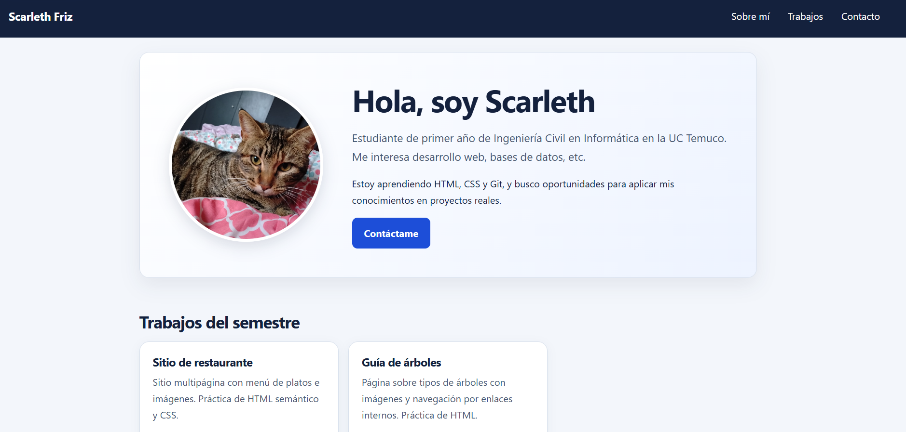
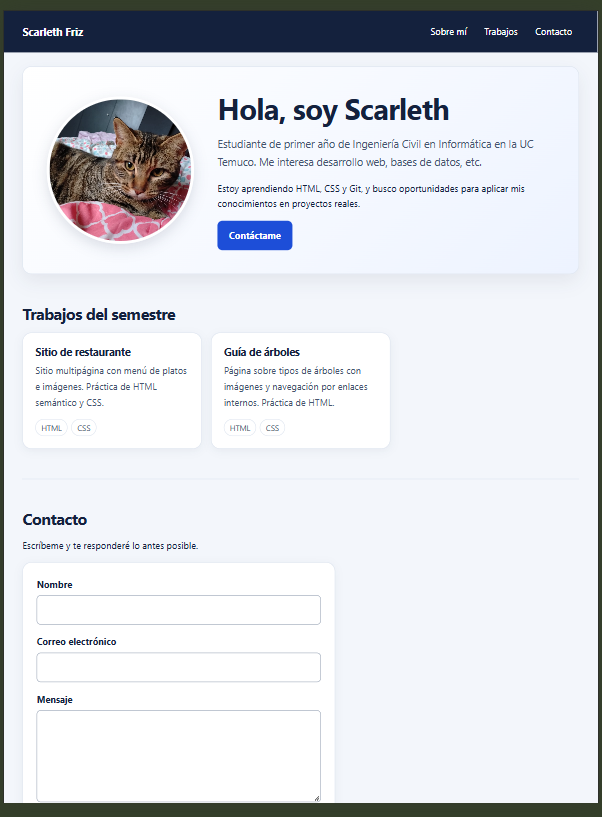
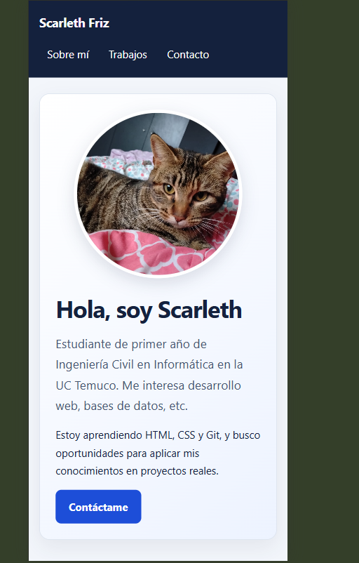

# Portafolio personal · Scarleth Friz

Portafolio web creado para la evaluación P2 de **ICINF1107 — Desarrollo de Frontend**, de Ingeniería Civil en Informática en la Universidad Católica de Temuco. Reúne una breve presentación personal y dos trabajos del semestre: un sitio de restaurante y una guía sobre árboles. También incluye un formulario de contacto.

## Audiencia y propósito

- **Audiencia principal:** docentes y personas interesadas en conocer mi trabajo.
- **Qué pueden encontrar:** mi perfil como estudiante de primer año, los proyectos realizados durante el semestre y una forma de escribirme.
- **Propósito:** presentar mis primeros trabajos de desarrollo web y mostrar lo que estoy aprendiendo de HTML, CSS y Git.

## Tecnologías

- **HTML5:** estructura semántica y contenido de las páginas.
- **CSS3:** estilos, variables, Flexbox, Grid y diseño adaptable a distintos tamaños de pantalla.
- **Git y GitHub:** control de versiones y alojamiento del repositorio.

## Cómo abrir el sitio

El portafolio es estático y no requiere instalar dependencias ni iniciar un servidor. Puedes descargar o clonar el repositorio y abrir `index.html` en un navegador.

```bash
git clone https://github.com/sfriz2025/P2-Presentaci-n-oral-interfaz-de-portafolio-versi-n-individual.git
```

## Estructura del proyecto

```text
.
├── index.html                 # Página principal del portafolio
├── CSS/
│   └── Style.css              # Estilos del portafolio
├── img/                       # Recursos de imagen del portafolio
├── JavaScripts/
│   └── Node.js
└── Proyectos/
    ├── Proyecto2/             # Sitio de restaurante
    │   ├── index.html
    │   ├── CSS/
    │   ├── IMG/
    │   └── paginas/
    └── Proyecto3/             # Guía de árboles
        ├── index.html
        ├── Css/
        ├── IMG/
        └── roble.mp4
```

## Proyectos incluidos

- **Sitio de restaurante:** presenta un restaurante y su oferta mediante una página principal, páginas de contenido e imágenes. Practica la organización de contenido con HTML y su presentación con CSS.
- **Guía de árboles:** reúne información e imágenes de distintos árboles y contiene un video sobre el roble. Practica la composición de una página informativa y la inclusión de recursos multimedia.

## Decisiones de diseño

- **Orden del contenido:** la presentación personal aparece primero para explicar quién soy; después se muestran los trabajos como evidencia de lo aprendido y, al final, el contacto.
- **Jerarquía visual:** el título principal y la presentación destacan al inicio. Los proyectos se separan en tarjetas para que sea sencillo recorrerlos y abrir cada uno.
- **Colores:** se usan azul oscuro (`#14213d`) para texto y cabecera, un fondo gris azulado claro (`#f3f6fb`) y azul (`#1d4ed8`) para enlaces y botones. Las superficies blancas y los bordes claros ayudan a distinguir las secciones.
- **Diseño adaptable:** los estilos parten de una pantalla pequeña. Desde 768 px, la presentación y la navegación se distribuyen en horizontal y los proyectos aparecen en dos columnas. Desde 1024 px, aumentan los tamaños y espacios, y la cuadrícula permite hasta tres columnas.

## Accesibilidad

- El documento declara el idioma español con `lang="es"` y usa regiones semánticas como `header`, `nav`, `main`, `section` y `footer`.
- Los encabezados siguen una jerarquía: un `h1`, títulos de sección `h2` y títulos de proyecto `h3`.
- El enlace «Saltar al contenido» permite omitir la navegación con el teclado.
- Los enlaces y controles muestran un indicador de foco mediante `:focus-visible`.
- Los campos del formulario tienen etiquetas asociadas mediante `for` e `id`, además de validación nativa para campos requeridos y correo electrónico.
- La hoja de estilos respeta la preferencia del sistema por reducir el movimiento.


## Visualización en distintos dispositivos

El portafolio se adapta a distintos tamaños de pantalla. Estas capturas muestran su visualización en computador, tablet y teléfono:

| Computador | Tablet | Teléfono |
|---|---|---|
|  |  |  |
## Aprendizajes y mejoras

- **Aprendizajes:** practiqué la estructura semántica en HTML, la creación de diseños adaptables con CSS y la organización de páginas y recursos en carpetas.
- **Próximas mejoras:** completar y revisar todas las páginas de los proyectos y verificar el contraste con una herramienta de accesibilidad.

## Autora

**Scarleth Friz**  
Universidad Católica de Temuco · Ingeniería Civil en Informática  
[Repositorio en GitHub](https://github.com/sfriz2025/P2-Presentaci-n-oral-interfaz-de-portafolio-versi-n-individual)
